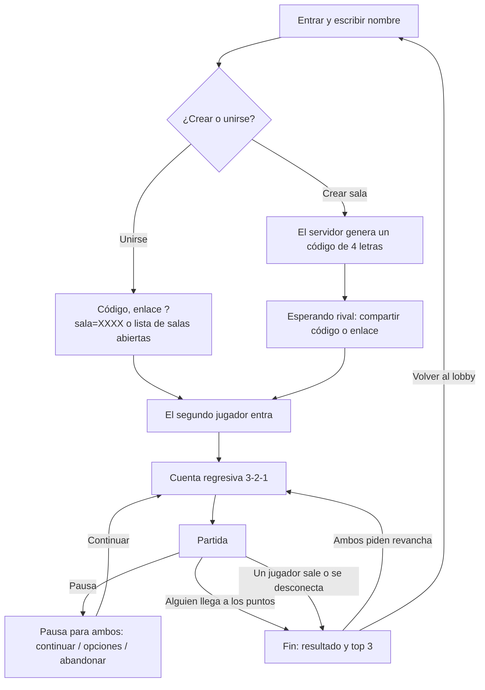

# 🏓 Pong 1 vs 1 en línea

Versión multijugador del juego *Pin-Pong VS Pared*. Dos jugadores se enfrentan en tiempo real desde la computadora o el celular, usando **Node.js + Express + Socket.IO**.

## Cómo ejecutarlo

```powershell
npm install
npm start
```

Abre `http://localhost:3000`. Para jugar desde el celular (en la misma red Wi-Fi), usa la dirección «En tu red» que aparece en la consola, por ejemplo `http://192.168.1.14:3000`. Si no carga, permite Node.js en el Firewall de Windows.

En Railway funciona tal cual: el servidor usa la variable `PORT`.

## Flujo del lobby



## Controles

| Dispositivo | Cómo mover tu paleta |
|---|---|
| Teclado | `W` / `S` o `↑` / `↓` (en Opciones se puede cambiar a `I` / `K`) |
| Ratón | Clic o clic sostenido y arrastrar sobre el tablero |
| Celular | Tocar o arrastrar el dedo sobre el tablero |
| Pausa | Botón ⏸, `P` o `Esc` (3 pausas por jugador; se pausa solo si cambias de pestaña) |

## Reglas

| Concepto | Valor |
|---|---|
| Puntos para ganar | 3, 5 o 7 (lo elige quien crea la sala) |
| Velocidad inicial | Fácil 4 · Normal 5 · Difícil 7 (px por paso a 60 pasos/s) |
| Niveles | Cada 3 golpes del mismo punto la pelota va un 10 % más rápida (tope 14) |
| Ángulo | Depende de dónde pega la pelota en la paleta (hasta 45°) |

## Cómo funciona

| Parte | Responsabilidad |
|---|---|
| `server.js` | Lobby, salas y **toda la física** (60 pasos/s). Valida cada mensaje: nombre, código, dirección, posición y límite de mensajes por segundo |
| `public/game.js` | Envía las entradas, dibuja interpolando entre las posiciones del servidor y predice tu paleta para que responda sin retraso |
| `public/index.html` | Pantallas (lobby, espera, pausa, opciones, fin) y diseño adaptable a celular |

Como el servidor es quien calcula la pelota y los puntos, ningún jugador puede hacer trampa modificando su navegador. Las opciones de colores y el historial de las 3 mejores partidas se guardan en el navegador de cada jugador.
